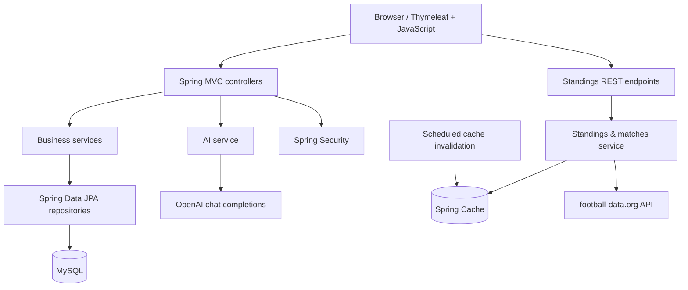

<div align="center">

# ⚽ Premier League Scores App

### Football scores, league standings, club profiles, and fan experiences — built with Spring Boot

A full-stack **Java web application** for exploring the English Premier League, following match results, learning about clubs, and connecting with other football fans.

**Spring Boot 3.3 · Java 17 · Thymeleaf · Spring Security · MySQL · REST APIs**

[](https://openjdk.org/)
[](https://spring.io/projects/spring-boot)
[](https://www.mysql.com/)
[](https://gradle.org/)
[](https://www.thymeleaf.org/)

[Features](#-features) · [Architecture](#-architecture) · [Getting started](#-getting-started) · [Endpoints](#-routes-and-api-endpoints) · [Deployment](#-deployment)

</div>

---

## 📖 Overview

**PremierLeagueScoresApp** brings football information and community-oriented functionality together in a server-rendered Spring application. It fetches Premier League standings and match data from [football-data.org](https://www.football-data.org/), renders club-specific information, and provides authenticated areas for fan conversations and user profiles.

Beyond the sports data, the codebase explores several backend engineering concepts: **layered architecture**, dependency injection, persistence with Spring Data JPA, authentication with Spring Security, validation, caching, scheduled jobs, internationalization, and event-based monitoring.

> **Project scope:** This is a portfolio/learning project. Some integrations rely on external credentials or services, and certain security and deployment settings need review before production use.

## ✨ Features

### 🏆 Premier League standings and match results

- Retrieves standings from the football-data.org v4 Premier League endpoint.
- Shows positions, points, and team names in a responsive table.
- Fetches match information and displays finished results or scheduled fixtures.
- Uses browser-side `fetch()` polling to refresh the displayed information **every 3 minutes**.
- Caches standings and match responses using Spring's `@Cacheable` abstraction, with a scheduled cache clear approximately **every 49 seconds**.

**Note:** This is API-based polling, not push-driven/WebSocket live scoring. The current match parser explicitly handles `FINISHED` and `TIMED` statuses.

### 🛡️ Dedicated club pages

The repository contains individual Thymeleaf pages and controllers for **20 Premier League clubs** from the season represented by the project's seeded data.

Club information includes:

- History and achievements.
- Supporters and fan culture.
- Trophies and club information.
- Links to club social-media channels and official resources.

Club content is backed by JPA entities and initialized from the application's seed data.

### 👤 Accounts and personal profiles

- Registration with username, email, password, age, and favourite club.
- Custom validation for unique email addresses and usernames, and for matching passwords.
- Form-based login using **email and password**.
- PBKDF2 password hashing through Spring Security.
- Profile view and username changes for authenticated users.
- `USER` and `ADMIN` roles represented in the persistence layer.

### 💬 Community chat

An authenticated fan discussion page is implemented directly in this repository:

- View posts from other fans, ordered by creation time.
- Add new messages with input validation.
- Delete messages through dedicated HTTP routes.
- Persist messages in MySQL via Spring Data JPA.

There is also a separate related repository, [PremierLeagueScoresApp-Chat](https://github.com/RosenTodorov2006/PremierLeagueScoresApp-Chat). The current codebase already includes its **own database-backed chat flow**; the separate project should not be confused with a mandatory dependency for that flow.

### 🤖 AI football assistant — Tony

The application includes a session-based chatbot named **Tony**, focused on questions about English football.

- Takes messages from a Thymeleaf chat interface.
- Sends requests to an OpenAI-compatible chat completions endpoint.
- Keeps the conversation in the HTTP session.
- Uses a football-focused system instruction and timeout/retry logic.

**Implementation detail:** The committed code requests `gpt-3.5-turbo`. Actual use requires a valid API key and a model supported by the configured provider; the model may need updating.

### 🌍 Internationalization

- Bulgarian and English resource bundles.
- Spring `MessageSource` integration.
- Locale switching using the `lang` query parameter.
- Cookie-based locale preferences.

### 🛠️ Administration and monitoring

- Admin-facing page for listing users and changing roles.
- Custom `@WarnIfExecutionExceeds` annotation and an aspect intended to monitor slow methods.
- Application events/listeners for error logging.
- Error views and handling for missing resources.

> The current HTTP security configuration requires authentication for protected routes but does **not** enforce role-based restrictions on every administration action. Review authorization before hosting the app for untrusted users. The AOP monitoring aspect may also require adding/configuring the appropriate AOP dependency to run as intended.

## 🧰 Technology stack

| Layer | Technology | Purpose |
| --- | --- | --- |
| Backend | Java 17, Spring Boot 3.3.0 | Application and business logic |
| MVC / rendering | Spring MVC, Thymeleaf | Server-rendered web pages |
| Persistence | Spring Data JPA, Hibernate, MySQL | Users, clubs, messages, and related entities |
| Security | Spring Security, PBKDF2 | Login, session security, password encoding |
| Validation | Jakarta Bean Validation, custom validators | Registration and form constraints |
| Football data | football-data.org v4, Spring `RestClient` | Standings and match information |
| AI integration | OpenAI Chat Completions API | Football Q&A assistant |
| Performance | Spring Cache, scheduled cache invalidation | Reuse of external API responses |
| Frontend | HTML, CSS, JavaScript, Thymeleaf | Responsive layout and periodic fetching |
| Localization | Spring i18n | Bulgarian / English text resources |
| Build / testing | Gradle, JUnit 5, Spring Boot Test, HSQLDB | Builds and application tests |
| CI/CD | GitHub Actions, Azure App Service | Build and deployment workflow |

## 🏗️ Architecture



The code follows a recognizable separation between controllers, services, repositories, entities, DTOs, configuration, and presentation templates.

### How the football-data flow works

```text
Browser loads homepage
         |
         v
GET /api/standings + GET /api/last-matches
         |
         v
Spring services check the cache
         |
         +--- Cache hit --> Return cached data
         |
         +--- Cache miss --> Request football-data.org
                                  |
                                  v
                             Parse JSON to DTOs
                                  |
                                  v
                             Return response
         |
         v
Browser renders the tables and polls again after 3 minutes
```

## 🗂️ Project structure

```text
PremierLeagueScoresApp/
├── .github/workflows/
│   └── master_premierleaguescores.yml    # GitHub Actions / Azure deployment
├── build.gradle                         # Dependencies and Java toolchain
├── gradlew / gradlew.bat                 # Gradle wrappers
└── src/
    ├── main/
    │   ├── java/bg/soft_uni/premierlegueapp/
    │   │   ├── configuration/            # Security, clients, locale, MVC beans
    │   │   ├── inits/                    # Initial roles, teams, competitions, etc.
    │   │   ├── models/                   # Entities, enums, and DTOs
    │   │   ├── repositories/             # Spring Data JPA interfaces
    │   │   ├── services/                 # Business logic and integrations
    │   │   ├── validation/               # Custom annotations and validators
    │   │   ├── monitoring/               # Events and listeners
    │   │   └── web/                      # MVC/REST controllers and advice
    │   └── resources/
    │       ├── application.yml           # Configuration
    │       ├── i18n/                     # Bulgarian and English messages
    │       ├── templates/                # Thymeleaf pages
    │       └── static/                   # CSS, JavaScript, and images
    └── test/                             # Unit/integration test sources
```

## 🔗 Routes and API endpoints

### Public endpoints

| Method | Route | Purpose |
| --- | --- | --- |
| `GET` | `/` | Homepage, club overview, standings, results |
| `GET` | `/api/standings` | Premier League standings as JSON |
| `GET` | `/api/last-matches` | Premier League fixtures/results as JSON |
| `GET` / `POST` | `/register` | Registration form / account creation |
| `GET` | `/login` | Login form |

### Authenticated endpoints

| Method | Route | Purpose |
| --- | --- | --- |
| `GET` / `POST` | `/profile` | Profile details / username change |
| `GET` / `POST` | `/chat` | View discussion / post message |
| `DELETE` | `/chat/{id}` | Delete a message |
| `GET` / `POST` | `/ai` | AI assistant conversation |
| `GET` | `/admin` | User administration page |
| `POST` | `/admin/{id}` | Change a user's role |
| `GET` | `/liverpool`, `/arsenal`, etc. | Club-specific pages |

**Access note:** The table describes routes in the code, not a guarantee that sensitive operations have adequate server-side authorization. All non-public routes are covered by the broad authenticated rule in the current `SecurityFilterChain`.

## 🚀 Getting started

### Prerequisites

- **JDK 17**.
- A working **MySQL** server and an initialized database schema.
- A **football-data.org API token** for football endpoints.
- An OpenAI API key **only if** you intend to use the Tony chatbot.
- Git. The project includes the Gradle wrapper, so a separate Gradle install is not necessary.

### 1. Clone the repository

```bash
git clone https://github.com/RosenTodorov2006/PremierLeagueScoresApp.git
cd PremierLeagueScoresApp
```

### 2. Configure MySQL

The committed `src/main/resources/application.yml` points to a specific Azure-hosted MySQL database. **Override these settings for your own environment** instead of depending on that database or committing your own credentials.

Create a local database and schema compatible with the project's entities. The configuration currently uses `spring.jpa.hibernate.ddl-auto: none`, so Hibernate will **not** create the tables automatically. Startup seed logic expects roles, team-related entities, and their tables to be available.

For local development, a JDBC URL can look like:

```text
jdbc:mysql://localhost:3306/liveScoresApp?createDatabaseIfNotExist=true&serverTimezone=UTC
```

### 3. Provide configuration through environment variables

Use Spring Boot environment overrides instead of editing secrets into tracked files.

**macOS / Linux:**

```bash
export SPRING_DATASOURCE_URL='jdbc:mysql://localhost:3306/liveScoresApp?createDatabaseIfNotExist=true&serverTimezone=UTC'
export SPRING_DATASOURCE_USERNAME='your_mysql_user'
export SPRING_DATASOURCE_PASSWORD='your_mysql_password'
export FOOTBALL_API_KEY='your_football_data_token'
export OPENAI_API_KEY='your_openai_api_key'
```

**Windows PowerShell:**

```powershell
$env:SPRING_DATASOURCE_URL = 'jdbc:mysql://localhost:3306/liveScoresApp?createDatabaseIfNotExist=true&serverTimezone=UTC'
$env:SPRING_DATASOURCE_USERNAME = 'your_mysql_user'
$env:SPRING_DATASOURCE_PASSWORD = 'your_mysql_password'
$env:FOOTBALL_API_KEY = 'your_football_data_token'
$env:OPENAI_API_KEY = 'your_openai_api_key'
```

Use a valid value for all placeholders required by the configuration. There are Cloudinary placeholders in `application.yml`, but a complete Cloudinary upload feature has **not** been verified in this repository.

### 4. Run the application

```bash
# macOS / Linux
./gradlew bootRun
```

```powershell
# Windows
.\gradlew.bat bootRun
```

The default Spring Boot HTTP port is **8080**, unless overridden by your environment. Visit `http://localhost:8080` once the application starts.

**Important:** Successful startup depends on the existing MySQL schema and valid configuration. This README documents the source code; it does not claim the application has been freshly executed in every environment.

## 🧪 Testing

The repository includes Spring Boot/JUnit test sources, including user-service and controller tests. Some test classes/methods are commented out; do not interpret their presence as full active test coverage.

To run the available tests:

```bash
./gradlew test
```

```powershell
.\gradlew.bat test
```

The test task is configured with JUnit Platform, and test dependencies include Spring Boot Test, Spring Security Test, and HSQLDB. **No test execution result is claimed here.**

## ☁️ Deployment

The repository contains a GitHub Actions workflow at `.github/workflows/master_premierleaguescores.yml`.

On a push to `master` (or manual dispatch), the workflow is configured to:

1. Check out the code and set up Java 17.
2. Build the application with Gradle.
3. Upload the built JAR as a workflow artifact.
4. Authenticate to Azure with configured GitHub secrets.
5. Deploy the JAR to an **Azure App Service** named `premierleaguescores`.

The workflow documents an Azure deployment pipeline; it does not imply that the production service is currently online.

## 🔐 Security and operational considerations

Before making this application available to untrusted users:

- **Rotate any database credentials previously committed in `application.yml`.** The repository is public, and removing a password from the latest file alone does not erase Git history.
- Keep football and AI API keys in environment variables or a secret manager.
- Enforce explicit server-side role checks for administrator actions and ownership/permissions checks for message deletion.
- Review the first-user-admin rule in account registration, registration password policy, and input handling.
- Review chatbot request construction, model availability, API costs, and timeout behavior.
- Ensure the database schema is managed using a repeatable migration process for new installations.
- Verify caching, monitoring/AOP configuration, and test coverage before a production release.

## 🧭 Potential improvements

- Add database migration scripts (Flyway or Liquibase).
- Strengthen authorization policies and expand automated security tests.
- Add deployment-ready `.env.example` and environment-specific config documentation.
- Move chat and AI configurations into strongly typed properties.
- Add end-to-end tests for registration, protected routes, and message ownership.
- Improve live match handling for in-progress statuses, API rate limits, and stale data.
- Create screenshots or a short demo GIF of the homepage and club pages.

## 🔗 Related project

[**PremierLeagueScoresApp-Chat**](https://github.com/RosenTodorov2006/PremierLeagueScoresApp-Chat) — a separate repository related to the fan-chat concept.

## 👨‍💻 Author

Developed by **[Rosen Todorov](https://github.com/RosenTodorov2006)** as a Java / Spring Boot portfolio project exploring football data integration, web application design, authentication, caching, and community features.

---

<sub>This is an independent educational/portfolio project and is not affiliated with the Premier League, its clubs, football-data.org, or OpenAI. Football data, trademarks, and club imagery remain the property of their respective owners.</sub>
